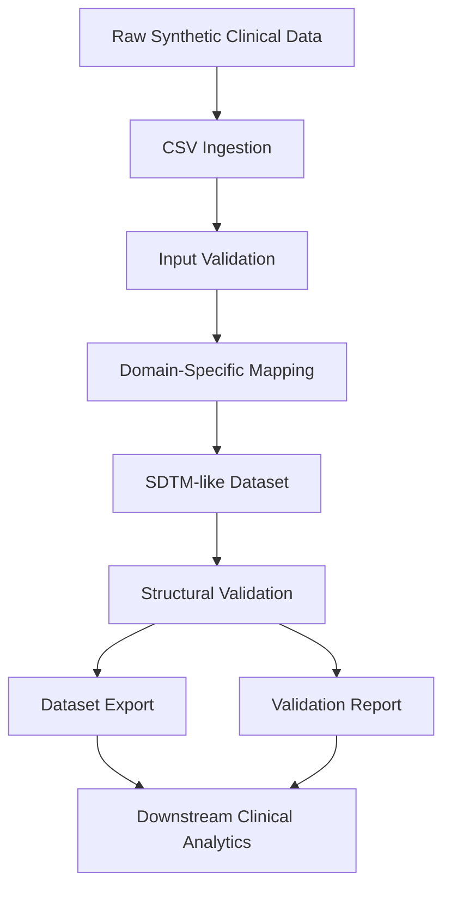

# SDTM Dataset Generator

[](https://www.r-project.org/)
[](https://www.cdisc.org/standards/foundational/sdtm)
[](LICENSE.md)
[](DESCRIPTION)
[](https://github.com/jeanmlv-dev/sdtm-dataset-generator/actions/workflows/R-CMD-check.yaml)

A practical and extensible R framework for transforming raw clinical trial data into standardized, SDTM-like datasets through reproducible mapping, structural validation, and automated data processing workflows.

## Overview

The **SDTM Dataset Generator** is an R package designed to demonstrate professional clinical data standardization practices using synthetic clinical trial data.

The project combines statistical programming, clinical data engineering, and software engineering principles to implement reusable workflows for transforming raw clinical data into structured datasets aligned with selected CDISC SDTM conventions.

The initial implementation focuses on the Demographics (DM) domain, providing an end-to-end pipeline from raw CSV ingestion to dataset generation, validation, and execution reporting.

## Key Features

- Modular R package architecture.
- Explicit raw-to-SDTM variable mapping.
- Clinical data transformation and standardization.
- Structural and data integrity validation.
- Reproducible CSV ingestion and export.
- Automated validation reports.
- Unit and end-to-end pipeline testing.
- Roxygen2 function documentation.
- Reproducible dependency management with renv.
- Extensible architecture for additional SDTM domains.

## Project Architecture



The architecture separates data ingestion, domain-specific transformations, validation, and export into reusable components.

## Implemented Domains

| Domain | Description | Status |
|--------|-------------|--------|
| DM | Demographics | Implemented |
| AE | Adverse Events | Planned |
| VS | Vital Signs | Planned |
| LB | Laboratory Test Results | Planned |

### Demographics (DM)

The DM module transforms synthetic subject-level demographics into a standardized subset of SDTM DM variables.

| Variable | Description |
|----------|-------------|
| STUDYID | Study Identifier |
| DOMAIN | Domain Abbreviation |
| USUBJID | Unique Subject Identifier |
| SUBJID | Subject Identifier for the Study |
| SITEID | Study Site Identifier |
| RFSTDTC | Subject Reference Start Date/Time |
| AGE | Age |
| AGEU | Age Units |
| SEX | Sex |
| ARMCD | Planned Arm Code |
| ARM | Description of Planned Arm |

The implementation includes subject identifier generation, study-specific treatment arm mapping, date validation, and structural integrity checks.

Detailed mapping specifications are available in:

[DM Mapping Specification](docs/dm-mapping.md)

## Technology Stack

| Component | Technology |
|-----------|------------|
| Programming | R |
| Clinical Data Standards | CDISC SDTM |
| Data Structures | tibble |
| Data Ingestion and Export | readr |
| Automated Testing | testthat |
| Documentation | Roxygen2 |
| Package Development | devtools |
| Dependency Management | renv |
| Version Control | Git and GitHub |

## Project Structure

```text
sdtm-dataset-generator/
├── R/
│   ├── generate_dm.R
│   ├── validate_dm.R
│   └── run_dm_pipeline.R
├── docs/
│   └── dm-mapping.md
├── inst/
│   └── extdata/
│       └── raw_dm.csv
├── man/
├── scripts/
│   └── run_dm_pipeline.R
├── tests/
│   ├── testthat/
│   │   ├── test-dm.R
│   │   └── test-dm-pipeline.R
│   └── testthat.R
├── renv/
├── DESCRIPTION
├── NAMESPACE
├── LICENSE
├── renv.lock
└── README.md
```

## Getting Started

### Prerequisites

- R 4.5 or later
- Git
- Rtools compatible with your R version, if required on Windows

### 1. Clone the Repository

```bash
git clone https://github.com/jeanmlv-dev/sdtm-dataset-generator.git
cd sdtm-dataset-generator
```

### 2. Restore the Project Environment

Open an R session in the project directory and run:

```r
renv::restore()
```

### 3. Load the Package

```r
devtools::load_all()
```

### 4. Execute the DM Pipeline

```r
result <- run_dm_pipeline(
  input_path = "inst/extdata/raw_dm.csv",
  study_id = "STUDY001",
  output_dir = "outputs"
)
```

Inspect the generated dataset:

```r
head(result$dm)
```

Inspect the validation report:

```r
result$validation_report
```

Alternatively, execute the demonstration script:

```r
source("scripts/run_dm_pipeline.R")
```

## Pipeline Outputs

The DM pipeline generates two output artifacts:

```text
outputs/
├── dm.csv
└── dm_validation_report.csv
```

| Output | Description |
|--------|-------------|
| dm.csv | Generated SDTM-like Demographics dataset |
| dm_validation_report.csv | Execution and validation summary |

The validation report includes check identifiers, descriptions, pass/fail status, input and output record counts, execution duration, and UTC execution timestamps.

## Example Execution

The included synthetic demographics dataset demonstrates the complete raw-to-DM workflow.

| Metric | Result |
|--------|--------|
| Study ID | STUDY001 |
| Synthetic Subjects | 20 |
| Output Records | 20 |
| DM Variables | 11 |
| Pipeline Validation Checks | 7 |
| Passed Checks | 7 |
| Execution Status | SUCCESS |

## Data Validation

The current implementation includes checks for:

- Required raw input columns.
- Non-empty input datasets.
- Unique subject identifiers.
- Valid study and site identifiers.
- Non-negative numeric age values.
- Supported sex values.
- Defined treatment arm mappings.
- Valid ISO 8601 calendar dates.
- Required DM variables.
- Unique USUBJID values.
- Consistent domain and study identifiers.
- Input and output record count reconciliation.

Invalid input or failed structural validation interrupts pipeline execution before successful output export.

## Testing and Quality Assurance

The package includes automated unit tests and end-to-end pipeline tests using `testthat`.

Run the test suite:

```r
devtools::test()
```

Run the complete package quality check:

```r
devtools::check()
```

### Initial Quality Check Results

| Check | Result |
|-------|--------|
| Automated Test Expectations | 34 passed |
| R CMD check Errors | 0 |
| R CMD check Warnings | 0 |
| R CMD check Notes | 0 |

The package quality check evaluates package structure, dependencies, documentation, examples, installation, and automated tests.

## Reproducibility

Project dependencies are managed with `renv`.

The `renv.lock` file records the dependency versions used during development, supporting consistent project restoration across development environments.

Generated datasets and execution reports are excluded from version control and can be reproduced by executing the pipeline.

## Project Roadmap

### Phase 1 — Project Foundation

- [x] R package structure
- [x] Reproducible dependency management
- [x] MIT license
- [x] Demographics domain implementation
- [x] Structural validation
- [x] End-to-end DM pipeline
- [x] Automated testing
- [x] Roxygen2 documentation
- [x] Clean R CMD check

### Phase 2 — Multi-Domain Expansion

- [ ] GitHub Actions continuous integration
- [ ] Adverse Events (AE) domain
- [ ] Vital Signs (VS) domain
- [ ] Laboratory Test Results (LB) domain
- [ ] Cross-domain subject consistency checks
- [ ] Reusable validation framework
- [ ] Metadata-driven mapping specifications
- [ ] Multi-domain execution pipeline

### Phase 3 — Advanced Clinical Data Engineering

- [ ] Controlled terminology integration
- [ ] Expanded SDTM metadata validation
- [ ] SAS XPT dataset export
- [ ] Enhanced execution and validation reporting
- [ ] Package vignettes and technical documentation

## Scope and Limitations

This project is an independent educational and professional portfolio initiative using exclusively synthetic clinical trial data.

The current implementation demonstrates selected SDTM mapping conventions and structural validation rules. It does not establish full CDISC SDTM compliance, regulatory submission readiness, or formal validation against an official CDISC conformance rule set.

The framework is designed to be progressively extended with additional domains, metadata specifications, and validation capabilities.

No confidential clinical trial data or proprietary employer datasets are included.

## License

This project is licensed under the MIT License.

See [LICENSE.md](LICENSE.md) for details.

---

## Author

**Jean Mendes**

Statistical Programming · Data Science · Data Analytics & Engineering · Machine Learning

[GitHub](https://github.com/jeanmlv-dev) · [LinkedIn](https://www.linkedin.com/in/jeanmlv/)
