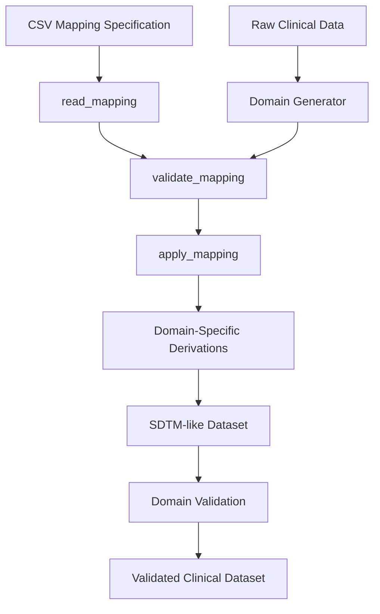
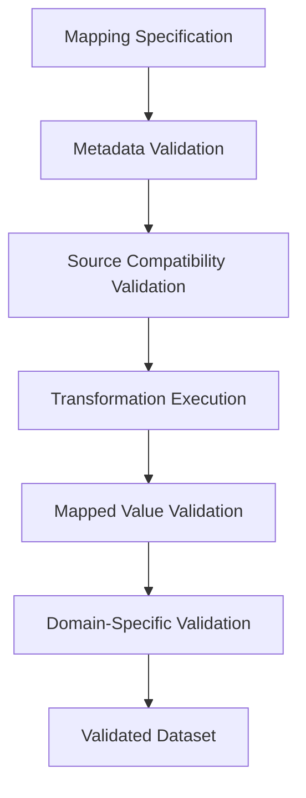

# Metadata-Driven Mapping Engine

## 1. Overview

The Metadata-Driven Mapping Engine provides a configurable and
reusable approach to transforming synthetic raw clinical trial
data into standardized SDTM-like datasets.

Instead of embedding all variable mapping rules directly within
domain-specific R functions, the engine allows selected
transformation rules to be defined in external CSV metadata
specifications.

The implementation separates:

- Source-to-target variable mapping.
- Controlled terminology transformations.
- Metadata validation.
- Domain-specific clinical derivations.
- Dataset-level validation.
- Clinical data quality checks.

The engine currently supports four SDTM-like domains:

| Domain | Description |
|--------|-------------|
| DM | Demographics |
| AE | Adverse Events |
| VS | Vital Signs |
| LB | Laboratory Test Results |

This implementation is intended for educational and demonstration
purposes using synthetic clinical trial data.

It does not establish full CDISC SDTM compliance.

---

## 2. Design Objectives

The Metadata-Driven Mapping Engine was developed with the
following engineering objectives:

- Reduce hard-coded variable mapping logic.
- Separate transformation specifications from implementation code.
- Improve mapping transparency and traceability.
- Promote reusable clinical data transformation components.
- Support consistent validation across clinical domains.
- Preserve backward compatibility with existing domain generators.
- Enable deterministic and reproducible dataset generation.
- Facilitate automated regression testing.
- Improve maintainability and extensibility.
- Provide a foundation for future multi-domain clinical pipelines.

---

## 3. Architecture

The engine follows a modular architecture in which generic
mapping operations are separated from domain-specific clinical
processing.



The architecture consists of three main layers.

### 3.1. Metadata Layer

Defines source-to-target mapping specifications using external
CSV files.

Responsibilities include:

- Source variable identification.
- Target variable identification.
- Transformation selection.
- Transformation parameters.
- Required-value declarations.
- Domain identification.

### 3.2. Mapping Engine Layer

Provides reusable functions for reading, validating, and
executing metadata specifications.

Core components:

- `read_mapping()`
- `validate_mapping()`
- `apply_mapping()`

### 3.3. Domain Processing Layer

Implements clinical rules that require domain-specific context.

Examples include:

- Subject identification.
- Referential integrity with DM.
- Study-day derivation.
- Record sequencing.
- Laboratory reference range evaluation.
- Vital signs unit conversion.
- Clinical date validation.
- Final dataset assembly.

This separation allows generic mapping logic to be reused
without removing the clinical context required by individual
SDTM domains.

---

## 4. Project Structure

```text
sdtm-dataset-generator/
|
|-- R/
|   |-- read_mapping.R
|   |-- validate_mapping.R
|   |-- apply_mapping.R
|   |-- generate_dm.R
|   |-- generate_ae.R
|   |-- generate_vs.R
|   |-- generate_lb.R
|   |-- validate_dm.R
|   |-- validate_ae.R
|   |-- validate_vs.R
|   |-- validate_lb.R
|   `-- utils.R
|
|-- inst/
|   |-- extdata/
|   |   |-- raw_dm.csv
|   |   |-- raw_ae.csv
|   |   |-- raw_vs.csv
|   |   `-- raw_lb.csv
|   |
|   `-- mappings/
|       |-- dm_mapping.csv
|       |-- ae_mapping.csv
|       |-- vs_mapping.csv
|       `-- lb_mapping.csv
|
|-- tests/
|   `-- testthat/
|       |-- test-mapping-engine.R
|       |-- test-metadata-dm.R
|       |-- test-metadata-ae.R
|       |-- test-metadata-vs.R
|       `-- test-metadata-lb.R
|
`-- docs/
    |-- dm-mapping.md
    |-- ae-mapping.md
    |-- vs-mapping.md
    |-- lb-mapping.md
    `-- metadata-mapping-engine.md
```

The mapping specifications are stored under `inst/mappings/`
so that they can be distributed as package resources.

---

## 5. Metadata Specification

Each mapping specification is represented as a CSV file.

The metadata schema contains six columns.

| Column | Description |
|--------|-------------|
| `domain` | Target clinical domain |
| `source_variable` | Variable in the source dataset |
| `target_variable` | Variable in the target dataset |
| `transformation` | Transformation rule to execute |
| `parameter` | Optional transformation parameter |
| `required` | Whether a non-missing target value is required |

### 5.1. Example Metadata Specification

The following example illustrates a subset of the DM mapping
specification.

```csv
domain,source_variable,target_variable,transformation,parameter,required
DM,NA,STUDYID,study_id,NA,TRUE
DM,NA,DOMAIN,constant,DM,TRUE
DM,subject_id,SUBJID,direct,NA,TRUE
DM,site_id,SITEID,direct,NA,TRUE
DM,age,AGE,numeric,NA,FALSE
DM,sex,SEX,terminology_map,sex,TRUE
DM,NA,AGEU,constant,YEARS,TRUE
```

Each row represents a mapping rule for a target variable.

The order of the metadata rows defines the order in which
mapping rules are processed by the generic engine.

Domain generators may subsequently arrange variables into
their expected output structure.

### 5.2. Required Variables

The `required` field identifies mapping rules for which
missing or empty values are not permitted.

```csv
DM,subject_id,SUBJID,direct,NA,TRUE
DM,age,AGE,numeric,NA,FALSE
```

In this example:

- `SUBJID` must contain a valid non-missing value.
- `AGE` may contain missing values, subject to additional
  domain-specific validation.

The metadata-level `required` flag is an implementation
constraint and should not be interpreted as an official
CDISC SDTM Core designation.

---

## 6. Supported Transformations

The engine supports a predefined set of transformation rules.

| Transformation | Purpose |
|----------------|---------|
| `direct` | Transfer source values to a target variable |
| `constant` | Populate a target variable with a fixed value |
| `study_id` | Populate the target with the supplied study identifier |
| `numeric` | Convert source values into numeric values |
| `terminology_map` | Transform source values using a named dictionary |

The transformation vocabulary is intentionally restricted.

Unsupported transformations are rejected rather than silently
ignored.

### 6.1. Direct Mapping

Transfers source values directly into the target variable.

```csv
DM,subject_id,SUBJID,direct,NA,TRUE
```

Example:

| Source: subject_id | Target: SUBJID |
|--------------------|---------------|
| 001 | 001 |
| 002 | 002 |
| 003 | 003 |

### 6.2. Constant Mapping

Populates a target variable using a fixed metadata parameter.

```csv
DM,NA,DOMAIN,constant,DM,TRUE
DM,NA,AGEU,constant,YEARS,TRUE
```

Example:

| DOMAIN | AGEU |
|--------|------|
| DM | YEARS |
| DM | YEARS |
| DM | YEARS |

### 6.3. Study Identifier Mapping

Populates the target variable using the study identifier
provided to the mapping engine.

```csv
DM,NA,STUDYID,study_id,NA,TRUE
```

Example:

```r
study_id <- "STUDY001"
```

Result:

| STUDYID |
|---------|
| STUDY001 |
| STUDY001 |
| STUDY001 |

### 6.4. Numeric Transformation

Converts source values into numeric values.

```csv
DM,age,AGE,numeric,NA,FALSE
```

Example:

| Source Value | Target Value |
|--------------|--------------|
| "35" | 35 |
| "48" | 48 |
| "62" | 62 |

Additional clinical restrictions, such as non-negative age
values, remain the responsibility of domain-specific validation.

### 6.5. Controlled Terminology Mapping

Transforms source values using a named terminology dictionary.

```csv
DM,sex,SEX,terminology_map,sex,TRUE
```

Example dictionary:

```r
terminology <- list(
  sex = c(
    "M" = "M",
    "F" = "F",
    "U" = "U",
    "Male" = "M",
    "Female" = "F"
  )
)
```

Example:

| Source Value | Target Value |
|--------------|--------------|
| Male | M |
| Female | F |
| U | U |

Unmapped non-missing terminology values are rejected.

Terminology dictionaries used in this project are demonstration
dictionaries and are not substitutes for official CDISC
Controlled Terminology, MedDRA, or other licensed clinical
coding dictionaries.

---

## 7. Core Engine Components

### 7.1. `read_mapping()`

Reads a CSV mapping specification and performs structural
validation of the metadata.

Example:

```r
mapping <- read_mapping(
  "inst/mappings/dm_mapping.csv"
)
```

Responsibilities include:

- Checking mapping file availability.
- Reading the metadata specification.
- Checking required metadata columns.
- Validating transformation declarations.
- Detecting duplicate target variables.
- Checking transformation parameters.
- Returning a structured mapping object.

### 7.2. `validate_mapping()`

Validates metadata rules and their compatibility with the
provided source dataset and terminology dictionaries.

Example:

```r
validate_mapping(
  mapping = mapping,
  raw_data = raw_dm,
  terminology = terminology
)
```

Responsibilities include:

- Metadata schema validation.
- Source variable availability.
- Target variable uniqueness.
- Transformation compatibility.
- Required source-value checks.
- Transformation parameter validation.
- Terminology dictionary availability.

The function returns `TRUE` when validation succeeds.

Invalid metadata or incompatible source data result in an error.

### 7.3. `apply_mapping()`

Executes the mapping rules against a source dataset.

Example:

```r
mapped_data <- apply_mapping(
  raw_data = raw_dm,
  mapping = mapping,
  study_id = "STUDY001",
  terminology = terminology
)
```

Responsibilities include:

- Processing metadata rules.
- Applying direct mappings.
- Assigning constant values.
- Populating study identifiers.
- Executing numeric transformations.
- Applying terminology dictionaries.
- Enforcing required target values.
- Returning mapped variables.

The mapping engine does not modify the original source dataset.

---

## 8. Domain Integration

The Metadata-Driven Mapping Engine is integrated with all
four supported domain generators.

Each generator accepts an optional `mapping_path` argument.

| Domain | Generator | Mapping Specification |
|--------|-----------|-----------------------|
| DM | `generate_dm()` | `dm_mapping.csv` |
| AE | `generate_ae()` | `ae_mapping.csv` |
| VS | `generate_vs()` | `vs_mapping.csv` |
| LB | `generate_lb()` | `lb_mapping.csv` |

### 8.1. Demographics (DM)

Metadata-driven operations include selected demographic
variable mappings, constants, numeric transformations,
and controlled terminology.

Domain-specific responsibilities include:

- Unique subject identification.
- USUBJID construction.
- Demographic source validation.
- Reference date validation.
- Study-specific treatment arm mapping.
- Final DM dataset structure.

### 8.2. Adverse Events (AE)

Metadata-driven operations include selected adverse event
variables and controlled terminology transformations.

Domain-specific responsibilities include:

- Subject linkage with DM.
- Source event identifier validation.
- Synthetic medical coding.
- Event chronology validation.
- Study-day derivation.
- Deterministic AESEQ assignment.
- Final AE dataset structure.

### 8.3. Vital Signs (VS)

Metadata-driven operations include selected vital signs
variables, test terminology, visit information, and
original measurement attributes.

Domain-specific responsibilities include:

- Subject linkage with DM.
- Supported test validation.
- Measurement unit validation.
- Temperature conversion from Fahrenheit to Celsius.
- Standardized result derivation.
- Assessment date validation.
- Study-day derivation.
- Deterministic VSSEQ assignment.

### 8.4. Laboratory Test Results (LB)

Metadata-driven operations include selected laboratory
variables, test terminology, visit information, and
original measurement attributes.

Domain-specific responsibilities include:

- Subject linkage with DM.
- Laboratory source identifier validation.
- Laboratory test classification.
- Measurement unit validation.
- Numeric result validation.
- Reference range validation.
- Standardized result derivation.
- Normal-range indicator derivation.
- Collection date validation.
- Study-day derivation.
- Deterministic LBSEQ assignment.

---

## 9. Backward Compatibility

Backward compatibility is a central design requirement.

Each domain generator supports two execution modes.

### 9.1. Legacy Mode

When `mapping_path` is omitted or explicitly set to `NULL`,
the existing domain-specific generation workflow is used.

```r
dm_legacy <- generate_dm(
  raw_data = raw_dm,
  study_id = "STUDY001"
)
```

### 9.2. Metadata-Driven Mode

When a mapping specification is supplied, the metadata-driven
workflow is enabled.

```r
dm_metadata <- generate_dm(
  raw_data = raw_dm,
  study_id = "STUDY001",
  mapping_path = "inst/mappings/dm_mapping.csv"
)
```

### 9.3. Output Equivalence

The supplied default metadata specifications are designed to
produce outputs equivalent to the legacy implementation.

```r
identical(
  dm_legacy,
  dm_metadata
)
```

Expected result:

```text
[1] TRUE
```

Equivalence is evaluated through automated regression tests.

Custom metadata specifications may intentionally modify
supported mapping behavior, provided that the resulting
dataset satisfies applicable validation requirements.

Invalid mapping specifications must not silently trigger
a fallback to legacy processing.

---

## 10. End-to-End Usage Example

The following example demonstrates metadata-driven generation
of all four supported domains.

Run these commands from the repository root in a development
environment.

### 10.1. Load the Package

```r
devtools::load_all()
```

### 10.2. Load Synthetic Source Data

```r
read_clinical_csv <- function(path) {

  readr::read_csv(
    path,
    col_types = readr::cols(
      subject_id = readr::col_character(),
      site_id = readr::col_character(),
      .default = readr::col_guess()
    ),
    show_col_types = FALSE
  )
}

raw_dm <- read_clinical_csv(
  "inst/extdata/raw_dm.csv"
)

raw_ae <- read_clinical_csv(
  "inst/extdata/raw_ae.csv"
)

raw_vs <- read_clinical_csv(
  "inst/extdata/raw_vs.csv"
)

raw_lb <- read_clinical_csv(
  "inst/extdata/raw_lb.csv"
)
```

Subject and site identifiers are explicitly read as character
values to preserve leading zeros.

### 10.3. Generate DM

```r
dm <- generate_dm(
  raw_data = raw_dm,
  study_id = "STUDY001",
  mapping_path = "inst/mappings/dm_mapping.csv"
)
```

### 10.4. Generate AE

```r
ae <- generate_ae(
  raw_data = raw_ae,
  dm = dm,
  mapping_path = "inst/mappings/ae_mapping.csv"
)
```

### 10.5. Generate VS

```r
vs <- generate_vs(
  raw_data = raw_vs,
  dm = dm,
  mapping_path = "inst/mappings/vs_mapping.csv"
)
```

### 10.6. Generate LB

```r
lb <- generate_lb(
  raw_data = raw_lb,
  dm = dm,
  mapping_path = "inst/mappings/lb_mapping.csv"
)
```

### 10.7. Validate Generated Datasets

```r
validate_dm(dm)

validate_ae(ae, dm)

validate_vs(vs, dm)

validate_lb(lb, dm)
```

Expected result for each successful validation:

```text
[1] TRUE
```

### 10.8. Inspect Generated Datasets

```r
dim(dm)
dim(ae)
dim(vs)
dim(lb)

head(dm)
head(ae)
head(vs)
head(lb)
```

The generated datasets can subsequently be exported or
integrated into downstream analytical workflows.

---

## 11. Validation Framework

The implementation follows a layered validation strategy.



### 11.1. Metadata Validation

Examples of metadata validation checks include:

- Missing mapping files.
- Missing metadata columns.
- Duplicate target variables.
- Unsupported transformations.
- Missing transformation parameters.
- Missing terminology dictionaries.
- Missing required domain mapping targets.

### 11.2. Source Data Validation

Examples include:

- Missing required source variables.
- Missing required source values.
- Invalid numeric values.
- Unsupported terminology values.
- Invalid subject identifiers.
- Duplicate source records.
- Invalid clinical dates.

### 11.3. Domain-Level Validation

Examples include:

- Primary key uniqueness.
- Required variable availability.
- Subject-level referential integrity.
- Study identifier consistency.
- Clinical date consistency.
- Study-day consistency.
- Standardized result consistency.
- Laboratory reference range consistency.
- Deterministic record sequencing.

Validation rules are applied according to the requirements
of each supported domain.

---

## 12. Clinical Data Quality Principles

The Metadata-Driven Mapping Engine supports several
fundamental clinical data quality principles.

| Principle | Implementation |
|-----------|----------------|
| Completeness | Required variable and value checks |
| Consistency | Standardized mappings and clinical rules |
| Uniqueness | Source and target key validation |
| Validity | Date, numeric, unit, and terminology checks |
| Referential Integrity | Subject linkage with DM |
| Reproducibility | Deterministic transformation workflows |
| Traceability | Explicit source-to-target metadata rules |
| Maintainability | Separation of metadata and clinical logic |

These principles provide a foundation for more comprehensive
clinical data quality assessment in future pipeline
implementations.

---

## 13. Automated Testing Strategy

The mapping engine is supported by automated tests implemented
using the `testthat` framework.

### 13.1. Core Engine Tests

```text
tests/testthat/test-mapping-engine.R
```

The core test suite covers generic mapping operations,
metadata validation, transformation execution, error handling,
and source data immutability.

### 13.2. Domain Integration Tests

```text
tests/testthat/test-metadata-dm.R
tests/testthat/test-metadata-ae.R
tests/testthat/test-metadata-vs.R
tests/testthat/test-metadata-lb.R
```

The domain integration test suites are designed to verify:

- Legacy and metadata-driven output equivalence.
- Dataset structure and variable consistency.
- Referential integrity.
- Required mapping target availability.
- Invalid metadata rejection.
- Unsupported transformation rejection.
- Deterministic output generation.
- Preservation of source data.
- Actual execution of metadata-driven rules.

### 13.3. Regression Testing

Regression tests verify that introducing metadata-driven
processing does not unintentionally modify existing
domain outputs.

```r
expect_identical(
  legacy_dataset,
  metadata_dataset
)
```

### 13.4. Metadata Behavior Testing

Output equivalence alone is not sufficient to demonstrate
that the metadata-driven workflow is being executed.

Tests must also verify that supported changes to metadata
rules affect the intended output variables.

This helps detect implementations that accept a mapping
path but silently continue using legacy processing.

### 13.5. Negative Testing

Negative tests verify that invalid inputs are explicitly
rejected.

Examples include:

- Nonexistent metadata files.
- Invalid metadata schemas.
- Duplicate mapping targets.
- Unsupported transformations.
- Missing required source variables.
- Invalid terminology values.
- Inconsistent subject references.

---

## 14. Running the Tests

### 14.1. Core Mapping Engine

```r
devtools::test(
  filter = "mapping-engine"
)
```

### 14.2. DM Integration

```r
devtools::test(
  filter = "metadata-dm"
)
```

### 14.3. AE Integration

```r
devtools::test(
  filter = "metadata-ae"
)
```

### 14.4. VS Integration

```r
devtools::test(
  filter = "metadata-vs"
)
```

### 14.5. LB Integration

```r
devtools::test(
  filter = "metadata-lb"
)
```

### 14.6. Complete Test Suite

```r
devtools::test()
```

### 14.7. Package Documentation

```r
devtools::document()
```

### 14.8. Package Quality Checks

```r
devtools::check()
```

The development quality target is:

```text
0 errors | 0 warnings | 0 notes
```

The project also includes a GitHub Actions workflow for
automated R package quality checks.

---

## 15. Error Handling Philosophy

The engine follows a fail-fast approach.

Invalid metadata, unsupported transformations, incompatible
source data, and inconsistent clinical records should be
identified before invalid datasets are released for
downstream processing.

The implementation avoids:

- Silent metadata failures.
- Silent fallback to legacy processing.
- Unsupported transformation execution.
- Unmapped terminology substitutions.
- Uncontrolled duplicate target variables.
- Undetected referential integrity violations.

Explicit error messages support debugging and facilitate
the identification of mapping and source-data issues.

---

## 16. Reproducibility and Traceability

External metadata specifications improve the transparency
of clinical data transformations.

Mapping specifications can be:

- Version-controlled using Git.
- Reviewed through pull requests.
- Compared across implementation versions.
- Evaluated independently of domain-specific R code.
- Validated through automated regression tests.

This provides a foundation for reproducible and reviewable
clinical data processing workflows.

The current implementation does not provide a complete
regulatory audit trail or formal electronic record
management system.

---

## 17. Design Decisions

### 17.1. Hybrid Metadata Architecture

The implementation intentionally combines generic metadata
mapping with domain-specific clinical processing.

Not every clinical derivation is represented as a generic
CSV transformation.

Complex operations such as study-day calculations, subject
linkage, record sequencing, laboratory range evaluation,
and measurement standardization remain within dedicated
domain processing logic.

This approach improves transparency while avoiding an
unnecessarily complex metadata execution language.

### 17.2. CSV-Based Specifications

CSV was selected as the initial metadata format because
it is:

- Human-readable.
- Easy to version-control.
- Compatible with spreadsheet-based review.
- Straightforward to parse in R.
- Suitable for tabular source-to-target specifications.

### 17.3. Restricted Transformation Vocabulary

The engine uses a predefined set of supported transformations
instead of evaluating arbitrary R expressions stored in
metadata files.

This improves predictability, testability, and maintainability.

### 17.4. Backward-Compatible Integration

Existing domain generators retain their legacy execution
mode.

This allows incremental adoption of metadata-driven
processing while maintaining compatibility with existing
tests and pipelines.

---

## 18. Limitations

The Metadata-Driven Mapping Engine currently has the
following limitations:

- Supports four demonstration SDTM-like domains.
- Uses synthetic clinical trial datasets.
- Implements a restricted transformation vocabulary.
- Supports selected source-to-target mapping rules.
- Retains domain-specific clinical derivations in R code.
- Uses demonstration terminology dictionaries.
- Does not implement official MedDRA coding.
- Does not implement comprehensive laboratory unit conversion.
- Does not generate regulatory submission-ready datasets.
- Does not generate Define-XML metadata.
- Does not establish full CDISC SDTM compliance.
- Does not replace formal clinical programming validation
  or regulatory submission validation tools.

The project is intended to demonstrate clinical statistical
programming, metadata-driven transformation, software
engineering, and automated clinical data validation concepts.

---

## 19. Future Enhancements

Potential future enhancements include:

- Unified multi-domain SDTM pipeline.
- Centralized clinical data quality reporting.
- Cross-domain consistency checks.
- Centralized terminology management.
- External terminology specification files.
- Extended transformation capabilities.
- Metadata version management.
- Mapping execution logs.
- Variable-level transformation lineage.
- Structured validation reports.
- Additional SDTM domains.
- Support for more complex clinical derivations.
- Define-XML generation.
- Additional clinical data export formats.

These enhancements represent potential development
opportunities and are not part of the current implementation.

---

## 20. Development Roadmap

| Stage | Description | Status |
|-------|-------------|--------|
| 1 | Project Foundation | Completed |
| 2 | Demographics Domain | Completed |
| 3 | Adverse Events Domain | Completed |
| 4 | Vital Signs Domain | Completed |
| 5 | Laboratory Test Results Domain | Completed |
| 6 | Testing and Validation Infrastructure | Completed |
| 7 | Metadata-Driven Mapping Engine | Completed |
| 8 | Multi-Domain Pipeline and Clinical Data Quality | Planned |
| 9 | Professional Documentation and Release v1.0.0 | Planned |

---

## 21. Related Documentation

Additional domain-specific mapping documentation:

- [Demographics Mapping](dm-mapping.md)
- [Adverse Events Mapping](ae-mapping.md)
- [Vital Signs Mapping](vs-mapping.md)
- [Laboratory Test Results Mapping](lb-mapping.md)

---

## 22. References

- [CDISC Study Data Tabulation Model](https://www.cdisc.org/standards/foundational/sdtm)
- [CDISC SDTM Implementation Guide](https://www.cdisc.org/standards/foundational/sdtmig)
- [CDISC Controlled Terminology](https://www.cdisc.org/standards/terminology)
- [R Project for Statistical Computing](https://www.r-project.org/)
- [testthat Documentation](https://testthat.r-lib.org/)
- [roxygen2 Documentation](https://roxygen2.r-lib.org/)
- [devtools Documentation](https://devtools.r-lib.org/)
- [readr Documentation](https://readr.tidyverse.org/)
- [renv Documentation](https://rstudio.github.io/renv/)

---

## 23. Disclaimer

This project is an independent educational and professional
portfolio implementation.

All clinical data used in this repository are synthetic.

The generated datasets represent selected SDTM-like structures
and are not intended for regulatory submission, clinical
decision-making, or production use without appropriate
validation.

The project is not affiliated with or endorsed by CDISC or
any regulatory authority.

---

## 24. Conclusion

The Metadata-Driven Mapping Engine establishes a reusable
foundation for configurable clinical data transformation.

By combining external mapping specifications, reusable
transformation functions, domain-specific clinical logic,
and automated validation, the implementation demonstrates
a structured approach to clinical statistical programming
and clinical data engineering.

The architecture provides a foundation for the next
development stage: a unified multi-domain clinical data
pipeline with centralized clinical data quality reporting.